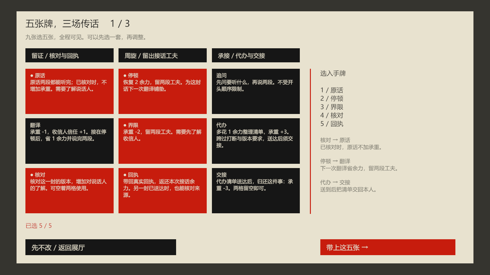

# 第三扇门 / The Third Door

一款关于传话的第一人称叙事策略试玩。你替两个人带话，要决定带哪两段、先说哪段，是否用掉一张卡，以及愿意替谁的安排担保。Unity 2022.3 URP，中文 / English。



第九版把工作案例做成一段完整的牌组实验：九张工具选五张，处理三场条件不同的传话，场间最多换一张。先商量交稿与评审，再核对改过的通知，最后交清下一步由谁来做。每场真正送完两封话，再去 03 收场；门前的两句回应不会直接跳到下一场。

留证、周旋、承接三套预设可以混搭。核对影响原话的成本，停顿为后续翻译留下窗口，代办整理清单后须把任务交回。卡改变处理局面的办法，基本传达、核对和交接仍可不用卡。家人案例保留第八版玩法，两案的既有结局和拼贴长卷仍可回看。

## 本地游玩

运行 [PlayDemo.cmd](Builds/Constructivist/PlayDemo.cmd) 或同目录的 `TheThirdDoor.exe`。便携包为 `Builds/TheThirdDoor_Constructivist_v9_Preview.zip`。

[包记录](Documentation/Package-v9.json)包含校验码和独立解压后的启动检查结果。试玩包是本地构建产物，不包含在源码仓库中。

**体验新版请选择工作案例《事由的空白》，开始新局。** 继续旧存档会沿用那一局的规则和原有进度。

| 操作 | 按键 |
| --- | --- |
| 移动 / 观察 | WASD / 鼠标 |
| 接话、休息、阅读实体纸卷 | E |
| 在门前打开传话夹、组句 | F |
| 手记 / 本局拼贴长卷 | Tab / V |
| 阅读长卷 | 滚轮 / ↑ ↓；左侧跳转轮次 |
| 中英切换，保留当前草稿 | F2 |
| 逐层返回 / 暂停 | ESC |
| 重述最后一次门前回应 | 家人及旧存档：G，获得卡后每局一次 |
| 重玩 / 结局后收起纸面 | R / 空格 |
| 结局后切换案例 / 返回目录 | N / Home |

先在门前听，再到收信人门前按 F，选择信封并点“拆开组句”。先点的片段先说，最多两段；点击已选片段可以移除。校样会展示完整措辞，确认后才消耗资源。取消不花费余力、卡牌或接话次数。

工作新局第一次在门前按 E，先选五张牌，确认后接话。每场在 00 长椅可休息一次。两边的公开安排都送到、代办已交接，去 03 才能选择进入下一场。收场恢复 2 余力、减 1 承重，下一场可换一张牌，再恢复使用次数。03 也允许离开。自动保存保留牌组、版本、任务、部分交付和接话次数。

## 传话的取舍

- **余力 0–8**：每次接话通常消耗 1；没有余力可以先休息，或用停顿。
- **承重 0–8**：没说完的安排和替人担保会增加负担；完整交付会减轻它。达到 6 后，门前承接和追问还会额外消耗余力。
- **直连 0–6**：实际信息到达和对话的准备程度。它不代替任何人的同意。

01 先要知道事情能否做到，02 先要知道怎么安排。有的人当下只能听一件；另一些时候会放下手里的事，让你说完。读人物的反应，决定分两趟说、换个开头，还是用掉一张卡。

每封话通常最多四次接话，工作新局的代办可以换第五次。已经听进去的项会保留，不能重复刷取效果。**把公开安排送到，同样能增加理解，不必问出所有私事。**

工作新局的九张牌是原话、停顿、追问、翻译、界限、代办、核对、回执、交接。五张手牌全可见，每张每场一次，在组句中使用。已核对的原话不加额外承重；停顿之后的翻译省余力并留出两段工夫；实际回执能节省回程余力。代办额外花 1 余力、承重 +3，送到后交回任务。

没有核对牌，可回说话人门前按 F 做基本核对；没有交接牌，可在收信人门前按 F 交回清单。基本动作需要余力。第二场必须核对版本，第三场对方赶时间，开头顺序和分次送达会更重要。

家人和旧规则存档仍使用原有七张分轮获得的牌，门前回应与传话共用，每种整局一次。

自己补的一句可能迅速换来一个铅笔填写的安排，但那不是本人的答复。你可以把真实两项补送到，修正这份安排；也可能留下“铅笔填满的日程”。先问过确认、后来才送到原话，仍可回本人门前按 F 再问一次安排。

私下内容必须实际听过才出现；未经允许传出会留下具体记录和信任损失。本人可不愿公开，即使信任你。实际听见的传话不能用重述擦掉。

原话、门前回应、卡牌与每次交付会进入本局拼贴长卷。七种结局通过不同物件组合呈现，文字写角色接下来做了什么。读档会重建这局的长卷。

## 本版范围与验证

这是一个可从选牌走到结局的三场实验，尚需通过真人试玩判断选牌与遭遇变化是否带来重玩价值。没有随机抽牌、商店、职业树或地图成长。

[本版设计](Documentation/Design-Iteration-v9.txt)解释规则与参考边界；[规则与验证范围](Documentation/Balance-v9.txt)区分新版、八版与旧存档检查；[试玩记录单](Documentation/Playtest-v9.txt)用于观察选牌、改计划和重玩的原因。

[检查报告](Documentation/QA-results.json)记录当前程序集、真实窗口矩阵及三套规则的单独统计；[八版报告](Documentation/QA-results-v8.json)保留此前完整矩阵。自动检查不能证明玩家觉得好玩。预览沿用原 Windows 播放器资源；全新 Unity 构建、干净机器验证、手柄全流程、玩家盲测及 Steam 提交仍待完成。

## 视觉与声音

展厅采用米白纸面、朱红圆盘、炭黑斜梁和巨型编号。三扇门围出三角动线，玩家在门之间行走、听话和交付。

承重增加时，悬挂的纸条增多，连线下垂；直连增加时，双方之间出现连接。结局会改变门的开合、围合、桌椅、光线和环形标记的运动。纸面纤维、脚步与环境滤波由代码控制。

工作案例增加公开工作计划和始终留白的事由栏。回执只在公开请求实际到达后改变；有限协议的桌面仍然留下空白。结局纸面可收起，便于回头查看自己的决定如何改变空间。

第五版使用内置 image_gen 生成三张原始插画：两张 1254×1254 案例拼贴已接入游戏，一张 1672×940 无字主视觉用于商店构图。插画采用纸白、朱红、炭黑和复印拼贴；标题、按钮、编号与状态由界面排字。第六版只改了配文，三张原图保持原样。

第七版参考所提供长图的留白、摄影剪贴和物件递进，新增一张 1254×1254 RGBA 九格物件图集，用在实体纸卷、长卷和校样中。完整提示词、透明通道与校验码保存在 `Documentation/ReferenceStudy-v7/`。参考作品留在研究目录，试玩包使用新生成的素材。

后续美术交付见 [可浏览制作单](Documentation/ArtDirection/index.html)、[提示词纯文字单](Documentation/ArtDirection/美术制作单与提示词.txt) 和 [放置示意](Documentation/ArtDirection/ArtPlacement.png)。包含 23 项素材规格、优先级、生成提示词、四张原图、六份可编辑 SVG、Anton 字体及许可。SVG 是排版稿，提交商店前仍需按模板导出 PNG/JPG。源图尺寸与校验码在 `AssetManifest.json`。

## 编辑与构建

使用 Unity **2022.3.62f3**，打开 `Assets/Scenes/ConstructivistDemo.unity`。原 `MainScene.unity` 场景资产保留，共用建场代码已迭代为新版。

常规构建：菜单 **Third Door → Build Constructivist Demo**，输出到 `Builds/Constructivist/`。工具直接构建专用场景，不替换当前打开的场景，并显式包含程序化材质需要的着色器。

此前本机缺少有效 Unity 许可；本轮继续复用原 `Builds/Windows` 播放器和资源，使用本机 Unity C# 编译器编译新版脚本，尚未完成全新 Unity BuildPipeline 打包。预览使用系统 Impact 字体回退；常规构建使用项目内的 Anton，中文使用系统字体回退。

```powershell
# 重新编译预览，并检查编辑器代码
./Tools/Build-Preview.ps1 -CheckEditor

# 独立关系模型的随机、穷举与边界检查
./Tools/Test-Model.ps1

# 主对话路线的资源轨迹（不包含传话操作组合）
./Tools/Explore-Balance.ps1

# 第九版三种牌组、换牌、零卡使用、续玩及旧规则回归矩阵
./Tools/Test-CaseDeck-Demo.ps1

# 单独检查第九版 4:3 布局
./Tools/Test-Demo.ps1 -Scenarios v9-office-paper-aspect-en -Width 1280 -Height 960

# 仅在当前程序集的实机验收全部通过后生成预览包
./Tools/Package-CaseDeck-Preview.ps1
```

构建脚本先完成编译再更新播放器，编译失败会保留已有程序集。实机测试使用 CharacterController、物理射线、UI 射线和按钮事件，检查布局、结算、回退、结局、通行、真实场景切换、JSON 存档与损坏恢复。结果和截图在 `Builds/Constructivist/QA/`；汇总在 `Documentation/QA-results.json`。测试存档使用隔离目录，不修改正常结局、语言与灵敏度记录。

运行时目标限帧 60，并关闭本机窗口模式中导致长等待的垂直同步。界面启动时从本机字体烘焙完整双语 SDF 字库，避免出现新句子时丢失首字；两套不可变字库在本次应用会话中复用，重玩不会反复分配。程序化场景材质、纹理、字体和网格有明确的清理流程。

## 双语文案维护

本机已安装英文 `humanizer` 和中文 `humanizer-zh`。后续对话可用 `$humanizer`、`$humanizer-zh` 指定编辑规则。游戏数值、许可、结局条件和有风险的回应须保留；人物对白按各自处境写，避免每句都由旁白再解释一次。

[编辑记录](Documentation/Editorial/Review-v6.txt) 包含来源、固定版本和示例；[逐句对照](Documentation/Editorial/CopyReview-v6.json) 记录实际修改。`Tools/Review-Copy.py` 仅供历史第六版文案审校使用；第八版已改变玩法与存档结构，不应对新版执行它来宣称规则未变。`Tools/Edit-Copy-v6*.py` 是已应用的编辑决定，不要重复运行。

## 代码入口

| 文件 | 职责 |
| --- | --- |
| `CaseDeckRun.cs` / `CaseDeckSave.cs` | 九选五、场间换牌、连携、具体任务与新版存档校验 |
| `CaseDeckPanel.cs` / `CaseDeckUIBuilder.cs` / `CaseDeckText.cs` | 选牌入口、五张手牌、三场对白与双语反馈 |
| `DispatchRun.cs` / `DispatchSave.cs` | 有序片段、接话长度、共享卡牌、暂定承诺、补送确认与新存档字段 |
| `DispatchComposer.cs` / `DispatchUIBuilder.cs` / `DispatchText.cs` | 组句操作、实际措辞、角色回复和新局结尾 |
| `RelationshipRun.cs` | 独立于 Unity 的关系、资源、卡牌、回退和结局模型 |
| `OfficeRun.cs` / `OfficeNarrative.cs` | 有限工作协议、公开请求送达条件与第二案例完整双语叙事 |
| `RelationshipSave.cs` / `CheckpointStore.cs` | 版本化模型存档、完整撤回快照、校验及备份恢复 |
| `CaseSession.cs` / `SessionUIBuilder.cs` | 案例选择、继续、重玩与返回目录 |
| `CaseInstallation.cs` / `CaseInstallationBuilder.cs` | 工作清单、留白的事由与实际交付回执 |
| `IllustrationLibrary.cs` / `CaseArtworkView.cs` | 原图加载、跨场景复用、选案图切换和图片缺失回退 |
| `IllustrationBuilder.cs` / `IllustrationStation.cs` / `ArtReflectionView.cs` | 物理展台、双语图像手记与放大阅读 |
| `CorrespondenceRun.cs` / `CorrespondenceText.cs` | 信件、许可、交付、隐私越界和修复 |
| `CorrespondenceFolio.cs` / `CorrespondenceUIBuilder.cs` | 门前传话与内容选择界面 |
| `NarrativeText.cs` | 三轮双语对白、反应、卡牌补充及七个结局 |
| `GameStateManager.cs` / `DialogueUI.cs` | 模型与场景衔接、读完再继续、即时语言切换 |
| `ConstructivistScene.cs` / `NarrativeInstallationBuilder.cs` | 展厅、门体、长椅、纸条与共同的桌子 |
| `RelationshipInstallation.cs` | 资源、连线、空间压力和结局装置变化 |
| `ExhibitionUIBuilder.cs` / `NarrativeUIBuilder.cs` | 标题、选择、卡牌、手记、逐句回看和档案 |
| `NarrativeNotebook.cs` / `NarrativeCardTray.cs` | 手记与卡牌交互 |
| `NarrativeRibbon.cs` / `NarrativeRibbonBuilder.cs` / `NarrativeRibbonStation.cs` | 本局拼贴长卷、附近页启用、实体纸卷和摄影剪贴排版 |
| `EndingArchive.cs` | 结局发现记录，隔离测试数据 |
| `ExhibitionResourceLifetime.cs` / `ExhibitionWorldType.cs` | 资源清理与有深度遮挡的文字 |
| `ExhibitionText.cs` / `NarrativeGlyphs.cs` | 双语 SDF 字库与印刷文字；不分发操作系统字体文件 |

## 素材与协作

沿用项目已有声音，来源记录在 `Assets/Resources/Audio/README_FREESOUND_LIST.md`。Anton 遵循 SIL Open Font License，副本在 `Assets/Resources/Design/Display-LICENSE.txt`。

原始立意和作品由人类设计师发起，早期代码由 Claude Code 协作完成。本轮系统、视觉和工程深化由 OpenAI Codex 按作者要求完成。源代码沿用原有 MIT 声明。
